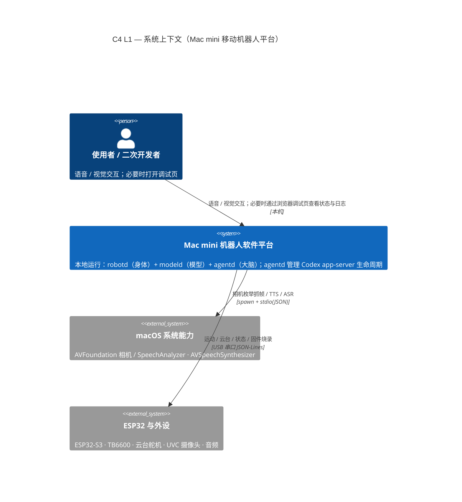
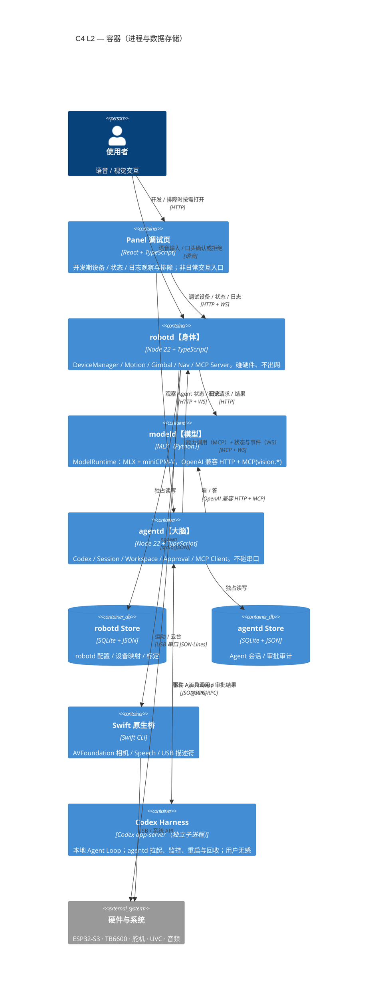
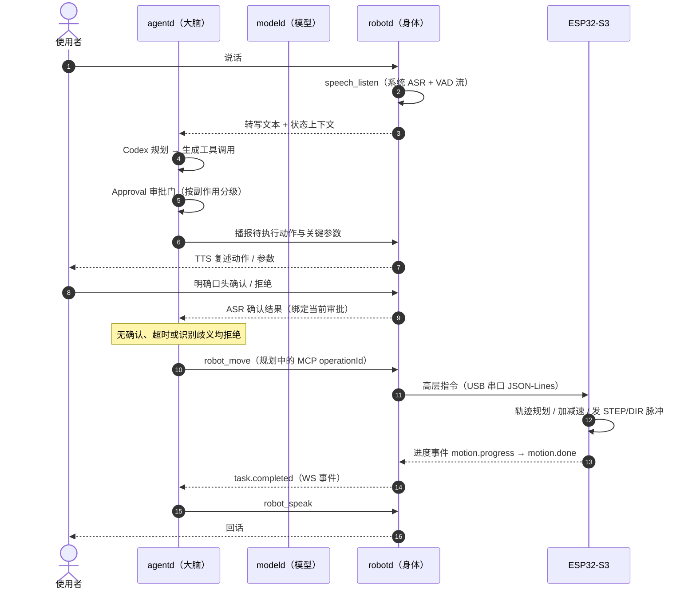
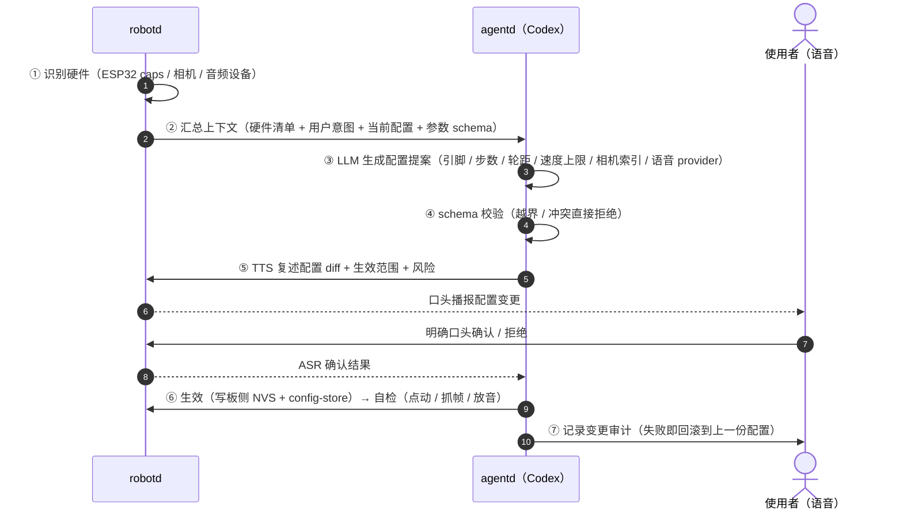

# Mac mini 移动机器人 — 架构设计（C4）

> **2026-10-21 选型更新**：[ADR-0009](decisions/0009-robotd-python-runtime.md) 已接受：
> **新架构 robotd 改用 Python**，面向感知、定位与 SLAM/导航扩展。旧 TS POC 已于
> 2026-10-23 整体删除，Python `robotd` 是当前唯一实现。
> 本文其余 Node/TS 容器图、代码示例及 `worker_threads` 方案保留为迁移前设计，
> 不作为新架构的实现选型；Python 控制隔离机制另行设计，既有时序与安全要求不变。
> `modeld` 仍是独立的慢模型进程，主要服务 `robotd`；`agentd` 可独立配置可选的更高级模型。

> **一句话**：给 24G Mac mini 装上「脚、眼睛、电池」——`robotd` 管身体、`modeld` 跑模型、`agentd` 管大脑，
> 三进程用 MCP / HTTP 缝合，本地全离线，可 DIY 复刻。
> **读之前**：「层」的定义以 [层与模块关系](layers-and-modules.md) 为唯一口径（本文用 C4 编号，务必带 `C4` 前缀）；
> 每个边界的传输选型见 [分层通信与接口设计](communication-protocol.md)；为什么这么定见 [决策日志](decisions/README.md)。
> **时效**：2026-10-19 按 C4 重组，合并原 `architecture` / `software-architecture` / `software-design` 三份 —— 当前有效。

> **本页导航**：[§1 目标与约束](#1-目标与硬约束)｜[§2 判据](#2-职责边界判据p1p5)｜[§3 硬件](#3-硬件架构)｜
> [§4 C4 总览](#4-c4-总览)｜[§5 L1 上下文](#5-c4-l1--系统上下文)｜[§6 L2 容器](#6-c4-l2--容器)｜
> [§7 L3 组件](#7-c4-l3--组件)｜[§8 L4 代码](#8-c4-l4--代码与关键契约)｜[§9 动态视图](#9-c4-动态视图)｜
> [§10 关键能力](#10-关键能力设计)｜[§11 成本](#11-成本预算)｜[§12 里程碑](#12-里程碑)｜[§13 风险](#13-风险与待确认)

---

## 1. 目标与硬约束

### 1.1 定位

给 Mac mini 装上「脚、眼睛、电池」，做成一个**简单易用、可 DIY 复刻**的移动机器人**平台**——
可二次开发、可定制，而非「一个机器人成品」：加个水桶能浇花、加个托盘能送物，价值在「它能长成什么」。
交互形态参考 WALL-E 式的「听、说、看」：**语音是主要输入/确认方式，语音与视觉构成日常交互；机器人无手臂，
不依赖触屏或机身按钮完成常规任务与审批**。浏览器页面是开发调试工具，不是日常操作台。
硬件零专用工具（组装侧只有「插、拧、贴」），软件允许有门槛、由 Agent 引导。
详见 [产品定位与套件化约束](product-positioning.md)。

### 1.2 功能目标

- **自由移动**：差速轮式底盘，步进电机 + TB6600 驱动。
- **视觉感知**：UVC 摄像头 + 两轴云台。
- **语音交互**：本地 ASR / TTS（系统能力）+ 视觉大模型。
- **自动回充**：低电量自动回坞充电。
- **开放平台**：可交给社区复刻、可二次开发与升级改造。

### 1.3 硬约束

| 约束 | 含义 |
| --- | --- |
| **数据全本地** | 所有数据保留在 Mac mini 本地，不上云（`HF_HUB_OFFLINE=1` 等硬保证） |
| **外设统一 USB** | 插拔即用、macOS 原生驱动，**不依赖任何私有驱动** |
| **Agent 友好** | 清晰的模块边界、标准接口、可被 AI 增量开发 |
| **语言分工** | 新架构 `robotd` 以 **Python** 为主；`agentd` / 面板保留 TypeScript，原生能力保留 Swift 桥（[ADR-0009](decisions/0009-robotd-python-runtime.md)） |
| **配置有 schema** | 每个模块用 **schema 声明自己的配置**；schema 用于校验与调试页展示，不要求用户通过文本框操作 |
| **物理动作必须审批** | 刷固件、写配置、驱动电机等按策略要求人工确认；正常路径通过语音复述与口头确认，不依赖调试页 |

### 1.4 成本目标（非硬约束）

除 Mac mini 外整套 BOM **≤ ¥400** 为研发期目标；套件售价另行测算（见 [产品定位](product-positioning.md) §5）。

### 1.5 非目标（本期不做）

机械臂 / 灵巧手；多楼层导航；室外场景；云端协同；多机协同；跨平台（先只做 macOS）。

---

## 2. 职责边界判据（P1–P5）

> 起因：讨论步进脱机 `ENA` 归哪层时发现——若给单个信号立一条专属规矩，就是「头疼医头」，
> 同类问题（IMU 采样、相机曝光、云台回中、故障降级……）会一个个再来。故立判据，
> **把「加规则」变成「推结论」**。

**元规则**：分层的依据是**责任**，不是功能清单。任何「这东西该放哪层」的问题，都由三问推导：
**谁拥有这项事实（真相）｜谁承担它出错的后果｜谁必须在什么时间尺度内做决定。**

| # | 判据 | 说明 | 典型落点 |
| --- | --- | --- | --- |
| P1 | **时间尺度** | 必须本地闭环、毫秒级 → 固件；10–100Hz / 秒级 → Runtime；秒级且需语义 → 应用层 | 脉冲与脱机时序 → 固件；`Nav` 局部避障 → Runtime；任务规划 → Agent |
| P2 | **真相归属** | 谁是该状态的权威，谁拥有它；**同一事实不许两层各存一份** | 步数 / 引脚电平 → 固件；位姿 / 模式 / 任务 / 设备 → Runtime；意图 → Agent |
| P3 | **后果归属** | 谁承担故障后果（失联 / 掉电 / 堵转 / 不可逆动作），谁就拥有默认值与兜底 | 看门狗停机、上电默认态 → 固件；运动互斥 → Runtime；审批 → 应用层 |
| P4 | **粒度** | 对外只暴露「**机器人能做什么**」（语义能力），不暴露「硬件怎么被操作」（引脚 / 寄存器 / 时序） | Agent 只见 OpenAPI 生成的语义工具（规划中的 `robot_move`）；`motor_set_pwm` 只能出现在固件层 |
| P5 | **旁路** | 安全与维护通道允许越过分层，但必须 ①显式命名 ②**不进 Agent 工具面** ③不成为常规路径 | 已有板侧看门狗、软件 STOP；拔 USB 与独立硬件急停是待验证项；维修脱机开关、串口调试 op |

**用判据判定已出现过的争论（结论都是推论，不是新增规则）**：

- **`ENA` 归固件**：P1（使能→等建立→发脉冲→停稳→脱机，是板侧毫秒级时序）、P2（引脚电平是固件的
  事实）、P3（host 失联时该不该脱机，必须由固件兜底）→ **固件执行**；Runtime 只给策略配置
  （`hold_ms` / 看门狗后是否脱机）；**应用层与 Agent 不暴露**（P4）；接线核对、量静置电流需要的
  手动开关走**调试旁路**（P5，见 [分层通信](communication-protocol.md) §2.1）。
- **`stop` 免审批、可抢占**：P3 + P5（安全旁路优先级最高）。
- **审批门只挂物理动作、不挂查询**：P3（只有不可逆后果才需要人把关）。
- **`Nav` 小策略留在 `robotd` 而非 `modeld`**：P1（10–50Hz 本地闭环不能跨进程等模型）。
- **引脚分配（静态）写进电气文档、引脚电平（运行时）由固件管**：P2（配置 ≠ 事实）。
- **Agent 看不到串口与引脚**：P4（粒度）+ P3（后果）。

**反面清单（自查用，出现即说明在打补丁）**：

1. 为单个信号 / 单个功能新增专属规则（应改为判据的推论）。
2. 同一事实两层都能改（违反 P2；例：host 与固件都能设 EN）。
3. 让上层下发明细时序（违反 P1；例：由 Agent 编排「先拉高 EN → 等 20ms → 发脉冲」）。
4. 把引脚 / 寄存器名暴露进能力面（违反 P4）。
5. 旁路没有显式命名，或混进了 Agent 工具面（违反 P5）。

---

## 3. 硬件架构

> 本节讲「是什么」；**引脚分配的唯一事实源是 [电气系统架构](electrical-architecture.md) §5.2**，
> 接线与拨码见 [步进驱动接线与供电](stepper-wiring.md)，此处只链不抄。

### 3.1 移动底盘（步进电机 + TB6600）

- **电机**：42 步进电机 ×2（42BYGH47，0.55N·m，带 2.54 杜邦头），差速驱动（两驱动轮 + 一万向轮）。
- **驱动板**：TB6600 步进驱动器 ×2（STEP/DIR 脉冲控制，9–42V）。
- **运动 MCU**：ESP32-S3（USB-CDC 直连 Mac），发 STEP/DIR 脉冲调速 + 方向控制。
- **USB 暴露**：macOS 识别为 `/dev/cu.usbmodem*` 或 `/dev/cu.usbserial*`，走 JSON-Lines 协议（§8.3）。
- **选型说明**：由直流电机方案改为步进——开环定位准、无需编码器闭环、驱动简单可靠。
- **当前物理状态（2026-10-09）**：左右两驱都已接上，`DRIVERS_PRESENT = ("L","R")` 已重烧并验证 ENA
  自动脱机；`steps_per_m` / `wheelbase_mm` 仍是占位值（8000 / 120），差速转向尚未标定。扩展两台（步进 3/4）未接。

### 3.2 云台 + 摄像头

- **摄像头**：USB UVC 摄像头（1080p 即可），macOS 经 AVFoundation 原生采集。
  - 深度相机（RealSense / OAK-D）超预算，本期不做，留作扩展。
- **云台**：两轴（pan/tilt）舵机 MG996R ×2 + 打印支架；由 ESP32 PWM 直驱（复用运动 MCU）。
- **判定流程**：四层判定（L1 枚举 / L2 驱动 / L3 接口类 0x0E / L4 出帧）的唯一事实源是
  [摄像头自动检测与配置](spec/camera-detection.md)。**必须看 L3**——只看 L1 会把私有协议摄像头误判为可用。

### 3.3 自动充电机构

- **对接**：磁吸触点 / 弹针（pogo pin），配合 IR 信标回充（Roomba 思路）。
- **检测**：IR 接收 + 触点到位检测 → 触发充电。
- **充电**：3S 锂电专用充电器 + BMS 管理。
- **流程**：低电量 → 回坞导航 → 触点对接 → 充电 → 充满离坞。

### 3.4 锂电池与电源（预算最大压力点）

> ⚠️ **关键约束**：Mac mini 是内置 AC 电源（100–240V），不能直接吃直流。电池供电必须加 **DC→AC 逆变器**。

- **电池**：3S 18650 组（11.1V 标称 / 12.6V 满电）+ 3S BMS。
- **逆变器**：纯正弦波 150–200W（M4 mini 空闲 ~7W、典型 ~20–40W、峰值 ~65W）。**勿用修正波**，易伤 Mac mini 电源。
- **降压**：DC-DC 出 5V（舵机 / ESP32 / 摄像头）。
- **续航估算**：3S 5000mAh ≈ 55Wh，按 30–40W 负载约 1–1.5 小时；纯待机更长。

拓扑与电源域的唯一事实源是 [电气系统架构](electrical-architecture.md) 与 [电源架构](power-architecture.md)。
**待核实**：M4 Mac mini 能否 DC 直供（先例在 M2 Pro 上降压到 12.6V，跳过内置 AC 电源）——若成立可去掉逆变器。

### 3.5 USB 统一总线与 macOS 适配

- 统一走 USB（原生 UVC + USB-CDC 串口），**不依赖任何私有驱动**。
- 设备寻址：用 USB VID/PID + 串口号，或用 `system_profiler SPUSBDataType` / IOKit 做稳定映射。
- 目标：**插上即用**，DeviceManager 自动枚举并注册类型化设备。

---

## 4. C4 总览

本文用 **C4 model** 的四个层次组织（外加一组「动态视图」）。每一层回答不同的读者问题：

| C4 层 | 回答 | 受众 | 本文 | 展开 |
| --- | --- | --- | --- | --- |
| **L1 系统上下文** | 平台与「人 / 外部系统」的边界 | 所有人 | §5 | 硬件边界见 §3 |
| **L2 容器** | 可运行 / 可部署单元（进程、数据存储） | 技术决策 | §6 | §6.5 进程边界决策 |
| **L3 组件** | 容器内部的模块划分 | 开发 | §7 | §7.3 模块归属权威表 |
| **L4 代码** | 关键接口 / 数据结构 | 实现 | §8 | 契约单一源 `contracts/` |
| 动态视图 | 运行时交互时序 | 所有人 | §9 | — |

> ⚠️ **编号提示**：C4 的 L1–L4 与本项目主口径（[层与模块关系](layers-and-modules.md) §3）的 L1–L4
> **差一位**——「**C4 L3 组件**」= 「本页 **L2 进程内模块**」。引用时一律带 `C4` 前缀。
> 对照表见 [层与模块关系](layers-and-modules.md) §7。

**层是位置类别，不是实例个数**：C4 L3 组件今天多一个、C4 L2 容器今天少一个，层数不变。

---

## 5. C4 L1 · 系统上下文

把一个**单机、数据全本地**的机器人软件平台放进它所处的环境。



**关键边界（L1）**

**交互约束**：机器人没有手臂，日常使用与物理动作审批必须通过语音交互；不假定用户能触碰机器人、操作机身按钮
或打开浏览器。视觉用于感知场景，不作为用户确认动作的信号。调试页只服务开发与排障。

**运行边界说明**：Codex app-server 属于整套平台的本地运行拓扑，是 `agentd` 处理复杂任务的底层 Agent Loop
实现。`agentd` 负责拉起、监控、重启与回收其生命周期；用户只与平台交互，不直接操作 Harness。
它作为第三方运行时依赖，不是本项目自研代码；C4 L1 将其纳入平台整体能力，C4 L2 则单独画出其进程边界。

| 源 | → 目标 | 协议 | 用途 |
| --- | --- | --- | --- |
| 使用者 | 平台 | 语音 / 视觉；可选浏览器调试页（`127.0.0.1`） | 主要交互与审批通过语音；调试页只用于查看状态、日志与排障 |
| 平台 | macOS 系统能力 | 子进程 stdio(JSON)（Swift 桥） | 相机枚举 / 抓帧、TTS、ASR |
| 平台 | ESP32 与外设 | USB 串口 JSON-Lines | 运动、云台、状态、固件烧录 |
| `agentd` | Codex app-server 子进程 | 本地 JSON-RPC（app-server） | 内部实现 Agent Loop；由 agentd 管理，用户无感 |

> **关键边界判断**：
> ① **Codex Harness 是平台内由 agentd 管理的第三方运行时依赖**，不是用户直接操作的外部系统；
> ② **模型（MLX / miniCPM-V）在平台内部**，由 `modeld` 单独一个进程承载——因此**换模型只动 `modeld`**，
> 不动身体（robotd）与大脑（agentd）。

---

## 6. C4 L2 · 容器

平台内部可运行 / 可部署的单元（进程与数据存储）。

### 6.1 容器视图



**容器清单（L2）**

| 容器 | 类型 | 技术 | 职责 | 生命周期 |
| --- | --- | --- | --- | --- |
| **Panel 调试页** | Web UI | React + Vite + TS | 开发期查看设备、状态、日志与排障；不承载日常交互或正常审批 | 开发者按需打开 |
| **robotd** | 后台进程 | Node 22 + TS | 身体：DeviceManager / Motion / Gimbal / Nav / MCP Server | `launchd` 常驻 |
| **modeld** | 后台进程 | MLX（Python） | 模型：MLX + miniCPM-V，OpenAI 兼容 + MCP（`vision.*`） | `launchd` 常驻（可重启回收内存） |
| **agentd** | 后台进程 | Node 22 + TS | 大脑：Codex / Session / Workspace / Approval | `launchd` 常驻 |
| **robotd Store** | 数据存储 | SQLite + JSON | robotd 配置 / 设备映射 / 标定 | 本地文件；仅 robotd 访问 |
| **agentd Store** | 数据存储 | SQLite + JSON | Agent 会话 / 审批审计 | 本地文件；仅 agentd 访问 |
| **原生桥** | CLI 进程 | Swift | AVFoundation 相机、Speech、USB 描述符 | 由 robotd `spawn` |
| **Codex Harness** | 平台内受管子进程 | Codex app-server | 复杂任务的 Agent Loop、工具、审批 | agentd 拉起、监控、重启与回收；用户无感 |

### 6.2 三个容器的分工

- **Panel 调试页**：只用于开发与排障，不是机器人日常交互入口或审批依赖。用户通过语音确认物理动作；
  机器人无手臂，不假设用户能触摸面板或机身按钮。软件 `robot_stop` 可由可信调试客户端绕开 Agent 调用，
  但它不等价于独立硬件急停。
- **`robotd`（身体）**：设备与运动。**碰硬件、不出网。**
- **`modeld`（模型）**：单独一个进程跑模型。**重活、可独立重启回收内存。**
- **`agentd`（大脑）**：Agent 编排。**不碰串口。**
- **分界 = MCP / HTTP**：`agentd` 作为 MCP 客户端连 `robotd` 与 `modeld` 两个工具面；视觉另走 OpenAI 兼容 HTTP。
- **控制隔离（目标设计，当前 POC 尚未实现）**：`robotd` 主线程处理 HTTP、Panel 与配置管理；
  独立 `worker_threads` Control Worker 持有 `Nav`、`Motion`、串口连接及运动状态的唯一写权限。
  主线程通过有界 `MessagePort` 发送命令/配置并接收快照/事件，不共享可变状态；运动路径不等待网络、模型、
  文件 I/O 或面板请求。`robot_stop` 必须走 Worker 的高优先级通道，绕过普通命令队列。

### 6.3 为什么切三个 daemon

| 理由 | 说明 |
| --- | --- |
| **故障 / 内存隔离** | 模型 OOM 或崩溃**不拖垮运动控制**——这是把 `modeld` 单拎出来的直接理由 |
| **权限隔离** | 大脑碰不到串口、身体不出网 |
| **可回收** | 模型进程重启即释放显存 / 内存 |

> 常驻 daemon 为三个：`robotd`、`modeld`、`agentd`。此外还有由 daemon 管理的子进程（Codex app-server、
> `robot-mcp`、Swift 原生桥等）；它们有各自进程边界，但不作为独立常驻 daemon 部署或由用户管理。
> `DeviceManager / Motion / Gimbal / Nav / MCP Server`（robotd）、`ModelRuntime`（modeld）、
> `Session / Workspace / Approval / MCP Client`（agentd）是各自 daemon 的进程内模块。

### 6.4 语言分工（新架构 Python 身体侧 + TS 应用侧）

| 层 | 语言 | 为什么不是 TS |
| --- | --- | --- |
| robotd / 设备 I/O / 感知与导航编排 | **Python** | 新架构主语言，便于连接感知与机器人算法；现有 TS POC 待迁移 |
| agentd / 面板 / 应用侧工具 | **TypeScript** | 保留应用编排与 UI 生态 |
| macOS 原生能力（AVFoundation / SpeechAnalyzer / AVSpeechSynthesizer） | **Swift**（小 CLI 桥） | TS 无法直接调 AVFoundation / IOKit / Speech |
| 推理引擎（miniCPM-V / 本地 LLM） | **MLX（Python，仅 macOS）** | 只跑 macOS（Metal），一个 venv 一套依赖；TS 以 HTTP / 子进程调用。**语音走系统能力，不用 MLX** |
| ESP32 固件 | **MicroPython**（`firmware/robot_server_v2.py`） | 跑在 MCU 上；框架问题后置（业务闭环优先） |
| 烧录 | `esptool-js`（TS）或 Python `esptool` 子进程 | 二者取一，见 §10.1-B |

**为什么 robotd 改用 Python**：身体侧未来要接入快速感知、定位建图与导航，优先降低算法接入成本；
重计算可使用原生库或独立工作进程，不要求纯 Python，也不因此合并 MiniCPM。
具体理由、代价与验收条件见 [ADR-0009](decisions/0009-robotd-python-runtime.md)。

**原 TS 选型理由（迁移前）**：① Codex 的 SDK / app-server 是 TS 友好的接入面；② 面板（React）与后端同语言，
配置 schema 能从服务直接流到 UI；③ MCP 工具、串口胶水、设备发现用 TS 生态（`serialport`、`zod`、`fastify`、`ws`）足够；
④ 机器人业务逻辑主要是**编排与 I/O**，不是重计算。

### 6.5 进程与线程边界

- **三个常驻 daemon**：`robotd`、`modeld`、`agentd`。此外有由 daemon 管理的子进程：
  `agentd` 管理 Codex app-server（复杂任务的底层 Agent Loop，用户无感），`robot-mcp` 负责工具适配，
  `robotd` 管理 Swift 原生桥。
- **Control Worker 是线程，不是第四个 daemon**：目标用 Node `worker_threads` 把 Nav/Motion 与管理事件循环隔离，
  不引入新的进程部署单元；状态与串口由 Worker 独占。
- **模型必须单独一个进程**：MLX 的内存占用大、可能 OOM——隔离出去，崩了也不拖垮运动控制。
- 只有需要独立故障域或单独回收资源的组件才提升为独立子进程；同一 daemon 内的职责模块不因模块化而各自起进程。

---

## 7. C4 L3 · 组件

### 7.1 三容器内部的组件

```mermaid
C4Component
    title C4 L3 — 组件（三个容器内部，模块不各自起进程）

    Container_Boundary(robotd, "robotd【身体】") {
        Component(management, "Management Plane", "Node main thread", "HTTP / Panel / 配置；不持有运动状态")
        Component(dm, "DeviceManager", "TS", "设备枚举 / 热插拔 / 稳定逻辑 id")
        Component(esp32, "├ ESP32", "TS", "端口 / 烧录 / 握手")
        Component(camera, "├ Camera", "TS + Swift 桥", "四层判定 / 抓帧")
        Component(audio, "└ Audio", "TS + Swift 桥", "系统 ASR / TTS + VAD 流")
        Component(perception, "Perception ★", "TS", "基础感知：连续抓帧收敛成事件流（② 型）")
        Component(control, "Control Worker", "Node worker_threads", "独立事件循环；持有 Motion / Nav / 串口与运动状态")
        Component(motion, "Motion", "TS · Control Worker", "底盘运动 / 里程计 / 任务互斥")
        Component(gimbal, "Gimbal", "TS · Control Worker", "云台 pan/tilt")
        Component(nav, "Nav", "TS · Control Worker", "导航策略 10–50Hz 软实时回路")
        Component(mcps, "MCP Server", "TS", "工具面（适配）")
    }
    Container_Boundary(modeld, "modeld【模型】") {
        Component(mrt, "ModelRuntime", "MLX / Python", "MLX + miniCPM-V")
        Component(mcps2, "MCP Server", "Python", "vision.* 工具面")
    }
    Container_Boundary(agentd, "agentd【大脑】") {
        Component(codex, "Codex Client / Supervisor", "TS", "app-server JSON-RPC 客户端；管理 Harness 生命周期")
        Component(session, "Session / Workspace", "TS", "会话与上下文 / 工作目录")
        Component(approval, "Approval", "TS", "审批门（分级放行）")
        Component(mcpc, "MCP Client", "TS", "调 robotd / modeld 工具")
    }

    Rel(agentd, robotd, "MCP + WS / HTTP", "")
    Rel(agentd, modeld, "OpenAI 兼容 HTTP + MCP", "")
    Rel(dm, esp32, "", "")
    Rel(dm, camera, "", "")
    Rel(dm, audio, "", "")
    Rel(dm, control, "发现后交接串口连接", "")
    Rel(management, control, "有界命令 / 配置", "MessagePort")
    Rel(control, management, "State / Event", "MessagePort")
    Rel(perception, control, "最新感知样本（有界消息）", "")
    Rel(nav, motion, "v/ω", "")
```

### 7.2 模块按「交互方式」分四类（与层正交）

**执行边界（目标设计）**：`robotd` 主线程承载 HTTP、Panel 与配置管理；独立 Node
`worker_threads` Control Worker 持有 `Nav`、`Motion`、串口连接及运动状态的唯一写权限。
两者通过有界 `MessagePort` 传递命令、配置、快照与事件，不共享可变状态；Control Worker 的实时路径不等待
网络、模型、文件 I/O 或面板请求。当前 POC 尚未拆分 Worker，本文的周期/时延预算是目标约束，不是现有保证。

「执行位置」回答**跑在哪**；这里补另一个正交的问题——**模块之间怎么交互**。定位一个模块要同时填两个坐标。

| 类型 | 交互形态 | 核心语义 | 是否持有真相 | 典型接口 | 例子 |
| --- | --- | --- | --- | --- | --- |
| **① 请求 / 应答型** | 调用 → 返回 | 「做这件事」 | 否（执行者） | `move(...)` `rotate(...)` | `Motion`、`Gimbal` |
| **② 感知 / 事件源型** ★ | **订阅 → 持续推流** | 「现在是这样的」 | **是**（它产出的事实） | `subscribe(cb)` / 事件流 | `Perception`、`Audio` 的 VAD 流 |
| **③ 整流 / 派生型** | 输入流 → 输出流 | 「把多路输入合成为一份事实」 | 是（派生事实） | 订阅上游 + `deriveMode()` | robotd 内核对事件流的归并（[ADR-0006](decisions/0006-robotd-event-driven-core.md)） |
| **④ 适配型** | 协议 A → 协议 B | 「翻译」 | 否 | — | `MCP Server`、`robot-mcp`、Swift 桥 |

> **② 型的三条接口约束**（必须显式写进契约）：① **有订阅起始帧**（订阅后立刻推一帧当前状态，
> 不能让订阅方「先 GET 一次」，否则退化成轮询）；② **带单调 `seq`**，出现 gap → 重拉快照，不依赖补发；
> ③ **不提供「查询当前值」的 getter 作为主路径**（直接 getter 会诱导调用方丢弃时间上下文，与 P2 冲突）。

### 7.3 模块归属权威表

> **本表是模块归属的权威。** 每个模块的层（L2）、所属进程、真相归属见
> [层与模块关系](layers-and-modules.md) §4——那份是全项目唯一口径。

**`robotd`（身体）**

| 模块 | 管什么（关键配置，面板可见可改） | 暴露工具 |
| --- | --- | --- |
| `DeviceManager` | 设备枚举 / 热插拔 / 稳定逻辑 id（下辖 ESP32 / Camera / Audio） | 设备列表工具待进入 OpenAPI |
| ├ `ESP32` | 端口、波特率、固件目录、握手协议版本 | 当前工具名以 OpenAPI `operationId` 为准 |
| ├ `Camera` | 设备索引 / 名称匹配、分辨率、帧率 | 当前工具名以 OpenAPI `operationId` 为准 |
| └ `Audio` | 麦克风 / 扬声器设备、语言（`zh_CN`）、音色（Tingting）、ASR 资产状态 | `audio_state` / `audio_mute` / `audio_unmute` / `speech_listen` / `robot_speak` |
| `Perception` ★ | 感知事实的产出（订阅式事件流）；示例名，可用现有等价模块名替换 | 规划中：`perception_*` 事件；非当前 OpenAPI 工具 |
| `Motion` | 每米步数、轮距、最大速度 / 加速度、引脚映射 | 规划中：`robot_move` / `robot_rotate` / `robot_stop` / `robot_state` |
| `Gimbal` | pan/tilt 引脚、角度范围、回中位 | 规划中：`gimbal_look_at` |
| `Nav` | 导航策略模型路径、控制频率、最大 v/ω、安全距离（第一版可空） | 规划中：`robot_navigate`；取消使用 `task_cancel` 或 `robot_stop` |
| `MCP Server` | 工具白名单、只读模式 | （供工具面） |

**`modeld`（模型）**

| 模块 | 管什么 | 暴露工具 |
| --- | --- | --- |
| `ModelRuntime` | 模型路径 / 量化、端口、显存 / 内存上限、空闲卸载、开机自启 | `vision.describe` `vision.vqa`（经 MCP）+ OpenAI 兼容 HTTP |

**`agentd`（大脑）**

| 模块 | 管什么（关键配置，面板可见可改） |
| --- | --- |
| `Codex` | app-server 启动参数、模型来源、沙箱策略 |
| `Session` | 会话 / 线程管理、上下文策略 |
| `Workspace` | 工作目录、可访问范围 |
| `Approval` | 审批策略（只读自动 / 副作用可配 / 危险强制）、审批记录 |
| `MCP Client` | 调 robotd / modeld 的工具 |

> **一个模块只允许出现在一行**。若某功能需要在两个进程里各有一份，说明它违反 P2——应改为
> 「一个持有真相 + 一个持有观测副本」，并在表里分成两行。

### 7.4 模块契约（面板「配置」的载体）

每个模块声明一个 **ModuleManifest**，配置中心与面板都从它生成：

```ts
interface ModuleManifest<C> {
  daemon: 'robotd' | 'modeld' | 'agentd';
  id: string;                     // 'esp32' | 'camera' | 'audio' | 'motion' | 'gimbal' | 'vision' | 'codex' | …
  name: string;                   // 面板显示名
  configSchema: z.ZodType<C>;     // 单一来源：运行时校验 + 面板表单 + 文档
  defaultConfig: C;
  status(): Promise<'starting' | 'ready' | 'degraded' | 'error' | 'stopped'>;
  tools?: ToolSpec[];             // robotd 侧模块暴露给 Codex 的工具（见 §8.2）
  start?(cfg: C): Promise<void>;
  stop?(): Promise<void>;
}
```

配置中心（每个 daemon 内置）：**持久化本进程模块的 `config`、按 schema 校验、热更新**。

---

## 8. C4 L4 · 代码与关键契约

C4 的 L4 通常不画全，只对「最关键的契约」展开。本项目有四处，主线是
**「契约的单一来源是文件，不是文档」**。

### 8.1 契约的单一来源

**接口的单一来源是 `contracts/openapi.yaml`**：先改契约，再 `npm run contract:generate` 生成
（MCP 工具面 + TS 类型），生成物随契约一起提交，`npm run contract:check` 必须通过。

| 契约 | 形态 | 位置 |
| --- | --- | --- |
| 模块契约 | `ModuleManifest<C>`（zod `configSchema` 为单一来源） | §7.4 |
| 原生桥契约 | `{"ok":true,"data":…}` / `{"ok":false,"error":…}`（stdio JSON） | §8.4 |
| robotd 能力面 | OpenAPI → MCP 工具面 + TS 类型 | `contracts/openapi.yaml` |
| 板侧线协议 | `{"id","op","args"}` → `{"id","ok","data"}`（JSON-Lines） | §8.3 · `contracts/wire-protocol.yaml`（待建） |

### 8.2 工具暴露（MCP / dynamic tools）

- `robotd` 与 `modeld` 各暴露一个 **MCP 工具面**，由 `agentd` 注册进 Codex。robotd 工具从其 OpenAPI
  `operationId` 生成；modeld 的 `vision.*` 属于独立命名空间，须由 modeld 自己的工具契约定义，不能混作 robotd API。
- 工具只做「薄封装」：参数校验（zod）→ 调模块 → 返回结构化结果；**不把业务规则写死在工具里**。
- **robotd** 面向 Agent 的公开工具名以 `contracts/openapi.yaml` 的 `operationId` 为唯一来源，生成器据此生成 MCP 名称
  （当前为 snake_case，如 `robot_stop`、`robot_follow`）。规划中的运动/导航 operationId 为
  `robot_move` / `robot_rotate` / `robot_navigate`，须先进入 OpenAPI 才算正式工具。
- 模块内部方法名（如 `Nav.goTo()`）不是 Agent 工具，也不是别名；Robot Skills 的 navigate/follow/stop 等
  是产品展示名，不构成第二套 API 名称。
- 工具粒度停在**机器人语义**，不下沉到硬件：禁止 `motor_set_pwm` / `gpio_write` / `servo_pwm` / `ena_set`。
- 工具按副作用分级（与审批策略绑定）：

| 分级 | 例子 | 策略 |
| --- | --- | --- |
| **只读** | `robot_state`、未来的 `camera_list` / `vision_describe` | 自动放行 |
| **有副作用** | 未来的 `robot_move` / `gimbal_look_at`，当前 `robot_speak` | 默认需审批（可配置） |
| **不可逆 / 危险** | 未来的 `robot_flash`、写设备配置、校准 | **始终需人工审批** |

> **产品层叫法 = Robot Skills**：Agent 只见 OpenAPI 生成的语义工具名；产品文案可显示
> `navigate / follow / stop / look / speak`，但这些展示标签不是工具别名。

### 8.3 板侧线协议（边界 B2 · 接口面 C）

传输：USB CDC；每行一个 JSON 对象，`\n` 结尾。

```text
命令（host → board，带 id）   {"id":7,"op":"move","args":{"left":0.30,"right":0.30,"speed":0.2}}
应答（board → host，同 id）   {"id":7,"ok":true,"data":{"task":null,"steps":[1000,1050]}}
失败（board → host，同 id）   {"id":7,"ok":false,"err":{"code":"E_BUSY","msg":"motion task running"}}
推送 / 事件（board → host）   {"ev":"motion.done","steps":[1000,1050],"ts":123456}
```

- `id` 由 host 单调递增；board 原样回填。**没有 id 的命令 = 最高优先级**（`stop` 专用）。
- 单位在 `hello` 里统一声明（米 / 弧度 / 秒），host 侧负责把语义换算成米——**板子不懂语义**。
- 命令集（v2 最小集）：`hello`（握手，含 `caps` / `steps_per_m` / `wheelbase_mm` / `calib_source`）、
  `move`、`rotate`（⚠️ 参数是 `steps`）、`velocity`（心跳兼连续控制，≥5Hz）、`stop`（幂等 / 可抢占）、
  `status`、`calib`（标定下发，[ADR-0002](decisions/0002-closed-loop-layering.md)）、`pump` / `gimbal`（预留）。
- 错误码：`E_BUSY` / `E_RANGE` / `E_STATE` / `E_FW` / `E_HW`（安全类优先级最高：板子先停机再上报）。
- 详设与已漂点见 [接口契约升级方案](contract-upgrade.md)；帧格式细节见 [分层通信](communication-protocol.md) §3。

### 8.4 原生桥契约（TS ↔ Swift CLI）

- 调用：`spawn(binary, [subcommand], { input: JSON })`，stdout 返回 `{"ok":true,"data":...}` 或 `{"ok":false,"error":...}`。
- **stdout 恰好一行 JSON**（诊断一律走 stderr），失败即重启，无常驻状态。
- 现有三座桥：

| 桥 | 谁 spawn | 为什么必须是原生的 |
| --- | --- | --- |
| `serial-bridge.py` | robotd | Node 没有 ioctl，清不掉 DTR/RTS ⇒ 串口开一次就复位板子 |
| `mac_speech.swift` | robotd（`speech_listen` / `robot_speak`） | ASR/TTS 只有系统 API（`SpeechAnalyzer` / `AVSpeechSynthesizer`）这一条路 |
| `uvc_capture.swift` | robotd（规划中的 `camera_capture`） | UVC 抓帧只有 AVFoundation 这一条路；TS 侧只拿「路径 + 尺寸 + 耗时」 |

- 所有桥禁止写 `raw/`、禁止把帧落进仓库——临时产物一律进 `work/`。
- **「一行 JSON」的例外**：`mac_speech.swift stream` 是**流式**的，stdout 吐 NDJSON
  （`ready` → 反复 `partial` → `final`）。停止方式是 **stdin 收到 `stop` 或 EOF**，所以 robotd 必须
  **保持子进程 stdin 打开**；这类桥**不能套超时**。

### 8.5 数据与配置模型

- **目标存储**：SQLite + JSON 文件，均在本地、无密钥。robotd 的 SQLite 用于跨重启保留模块配置、
  设备映射与标定；agentd 的 SQLite 用于审批结论/审计及会话元数据。JSON 仅用于静态清单/导入导出，不与 SQLite
  形成两个可写真相源。robotd 与 agentd 各自独占数据库/文件；
  不共享数据库文件、不跨进程直连对方数据文件、不共同写表。Panel 只能经 daemon API 访问。
- **媒体边界**：数据库不存音频、视频、帧图或原始感知流；语音/视频是输入方式，不代表默认留存媒体。
  若未来需要保存转写或媒体，须另行确定留存范围与用户授权。
- **实现状态**：当前 POC 未落地 SQLite/持久化 Store；以下是目标归属，不应理解为已存在的数据层。

| 所有者 | 数据 | 关键字段 / 语义 |
| --- | --- | --- |
| `robotd` | `ModuleConfig`、`Device`、`Firmware` | 配置由 schema 校验；稳定设备映射与固件目录只由 robotd 管理 |
| `robotd`（内存） | `RobotState`、活动 `Task` | 运行时唯一真相；重启后重新握手/恢复，不由 agentd 镜像 |
| `robotd`（事件流） | `Event` | `ts, topic, payload, seq`；增量推送，不作可重放持久日志 |
| `agentd` | `AgentThread`、`Approval`、审计记录 | `Approval` 的结论权威归 agentd；robotd 只收到获准后的能力调用 |
| `modeld` | 模型权重与推理配置 | 文件由 modeld 配置指向；不与 daemon 共用应用数据库 |

- **配置单一来源**：`ModuleConfig.config` 的结构由 §7.4 的 `configSchema` 定义，
  **面板表单、运行时校验、文档三者同源**。
- 记忆 / 历史不塞进 Agent 上下文，按需检索（embedding Top-K）。

### 8.6 统一契约：Capability / State / Task / Event

四类东西就是全部。Agent 的闭环 = 查能力 → 看状态 → 调工具 → 跟任务 → 收事件。

```jsonc
// 1) Capability —— “能做什么”
{ "name": "robot_move",
  "args": { "left_m": 0.3, "right_m": 0.3, "speed_mps": 0.2 },
  "returns": "rpc | task",
  "requires_approval": true }

// 2) State —— “现在怎样”（快照，覆盖语义）
{ "ts": 1760000000.000, "mode": "idle | moving | navigating | degraded | error",
  "pose": { "x": 0.0, "y": 0.0, "theta": 0.0 },
  "battery": { "voltage": 12.4, "percent": 72 },
  "devices": { "esp32": "ready", "camera": "ready", "pump": "off" },
  "task_id": null }

// 3) Task —— “正在做什么”（增量，带生命周期）
{ "task_id": "t-abc123", "capability": "robot_navigate", "state": "running",
  "progress": 0.4, "started_at": 1760000000.000, "cancelable": true }

// 4) Event —— “发生了什么”（增量，不重放）
{ "ev": "task.completed", "task_id": "t-abc123", "ts": 1760000031.500 }
```

约定：

- **State 是合取，Event 是增量**。重连后先拉一份 State 对齐，再订阅 Event；Event 带单调序号，
  出现 gap 就重新拉 State，而不是等重放。
- **`state` 与 `events` 是同一份真相的两种视图**，不是两个可选方案：`GET /v1/state` 是订阅的「第 0 帧」，
  WS `/v1/events` 是后续帧。
- **Task 必须可取消**（`stop` 或 `task.cancel`），且只有一个运动任务在跑。
- `requires_approval` 是能力的属性，不是 Agent 的自觉——审批门读它。
- **错误必须分层**：`{code, message, layer, retriable}`，`layer ∈ contract|business|upstream|degraded|adapter`。
  **`retriable` 进契约**——让「物理动作不重试」这条纪律成为**可被读取的字段**，而不是靠背文档。

---

## 9. C4 动态视图

### 9.1 链路 A：语音 → Agent → 动作



### 9.2 Task 生命周期与抢占

```text
         ┌──────────────────────────────────────────────┐
         │                                              │
created ─► running ─┬─► completed        （正常结束）    │
         (started) │                                   │
                   ├─► failed           （错误 / 超时 / 板侧复位）
                   ├─► cancelled        （stop / task.cancel / 抢占）
                   └─► superseded       （被更高优先级任务取代）
```

- `superseded` 与 `cancelled` 必须区分：`stop` 抢占后原任务记 `cancelled` 是**语义失真**——
  它不是被取消的，是被取代的。上层的重试策略对这两者应该不同。
- **`stop` vs `estop`（目标语义，非当前实现）**：当前只实现 OpenAPI `robot_stop`（有序软件停止）；
  `estop` 命令、工具及 `estop: true` 事件字段均待实现，不能把它描述为现有能力（见 [ADR-0004](decisions/0004-serial-contract-redlines.md)）。
  未来物理急停须是独立于 daemon、Worker、串口与软件 `robot_stop` 的硬件断能/禁止驱动路径；具体电路未定且未验证，
  不能以面板软件按钮替代，也不能声称已经具备。
- **`stop` 是唯一、幂等、可抢占的最高优先级命令**，能打断任何任务；机器人只有一个身体
  → 同一时刻只允许一个运动任务，`RobotState.mode` 就是这把互斥锁。

### 9.3 链路 B：首次开机自动配置



> **为什么必须有人审批**：写错引脚可能烧硬件、写错步数可能撞墙；LLM 只给**提案**，不给最终权威。
> **配置提案的可信边界**：LLM 可以建议参数值，但**参数合法性、互斥、量程由 schema 与硬件约束把关**。

### 9.4 链路 C：看一眼并回答

规划中的 `camera_capture` → 缩放到长边 768–1024px / JPEG q≈80 → modeld `vision.vqa` → 文本回 Agent / 调试页。
**单帧 0.3–3s，`Nav` 永远不等 modeld**——「看一眼」是异步的，`v/ω` 是本地算的。

---

## 10. 关键能力设计

### 10.1 ESP32 自动识别 · 刷固件 · 自动配置

#### A. 自动识别

1. 端口枚举：`serialport` 列出所有串口 + USB 元数据（VID/PID/序列号/厂商）。
2. 匹配表：

   | VID | 芯片 / 桥 | 端口形态 | 说明 |
   | --- | --- | --- | --- |
   | `0x303A` | Espressif 原生 USB | `/dev/cu.usbmodem*` | ESP32-S3 片内 USB（「双 USB 口」） |
   | `0x10C4` | Silicon Labs CP210x | `/dev/cu.usbserial*` | 桥接芯片 |
   | `0x1A86` | WCH CH34x | `/dev/cu.usbserial*` | 桥接芯片 |
   | `0x0403` | FTDI | `/dev/cu.usbserial*` | 桥接芯片（**本项目当前用这颗**） |

3. 芯片确认：`esptool chip_id`（或 esptool-js 等价调用）读芯片型号 / 版本，避免「插了但不是 ESP32」误判。
4. 区分「烧录口 vs 原生 USB 口」：烧录 / 调试用丝印 `COM` 口（USB-UART 桥接），原生 `USB` 口（`usbmodem`）
   用于把板子当 USB 设备——识别逻辑要把两者都认出来并按用途标注。

#### B. 固件刷写

- **固件目录 firmware-catalog**（本地、可版本化）：每条记录含 `chip`、`board`、`version`、`entry`（bin 路径）、
  `checksum`、`flashArgs`。固件本体放 `work/firmware/`（不入库，遵守 [AGENTS.md](../AGENTS.md)「大文件 / 二进制不入库」）。
- 两条烧录路线（二选一，待实测）：
  1. **`esptool-js`（TypeScript）**：与主语言一致、无额外 Python 依赖；但它面向 **Web Serial**，在 Node 里
     需要 Web Serial polyfill 或原生串口适配——**需 PoC 验证**。
  2. **Python `esptool` 子进程**：最稳；代价是多一个 Python 运行时依赖。
- 流程：`擦除 → 烧写 bootloader/partition/app → 校验 → 复位 → 握手`。烧录前**强制语音审批**，烧录中调试页可观察进度与日志。
- **安全状态分层**：板侧心跳看门狗（300ms 未收到运动心跳即停）已在固件/POC 验证；
  协议目标还要求 USB 断开后停机，但需装车验证。面板 `robot_stop` 是软件有序停止，不等于硬件急停。
  硬件急停按钮及其独立断能路径尚未实现/验证；固件 `estop` 命令也尚未落地，均不可计入现有兜底。

#### C. 自动配置（依赖 LLM + Codex）

见 §9.3。核心是**把「用户说了一句人话 → 板子 / 外设被正确配置」做成一条闭环**。

### 10.2 摄像头自动识别

复用 [摄像头自动检测与配置](spec/camera-detection.md) 的**四层判定模型**，在 TS 侧重实现（判定逻辑不变，工具换语言）：

| 层 | 判据 | TS 侧实现 |
| --- | --- | --- |
| L1 枚举 | `system_profiler SPUSBDataType` 有设备 | 解析命令输出（或 `ioreg`） |
| L2 驱动 | `system_profiler SPCameraDataType` 有相机 | 解析命令输出 |
| L3 接口类（决定性） | 存在 `bInterfaceClass=0x0E`（UVC） | 调 `usb-probe`（复用探针） |
| L4 出帧 | 真能抓到一张 JPEG | `uvc_capture.swift capture`（AVFoundation） |

- **必须看 L3**：只看 L1 会把私有协议（接口全 `0xFF`）的摄像头误判为可用。
- 输出：`camera.list() -> [{index, name, uvc, vid, pid}]`，面板列出并让用户选定视觉源；**不写死索引**。
- **权限**：首次要在「系统设置 → 隐私与安全性 → 摄像头」给承载采集的进程授权，否则枚举为空（与「没插」同表现）。

### 10.3 视觉：快慢双路径

**两条感知路径（重要）**：VLM 是「慢而通用」，**不能只靠它**——避障、找目标需要「快而专用」的检测器：

| 路径 | 用什么 | 延迟 | 给谁用 |
| --- | --- | --- | --- |
| **快** | 先用**系统自带 Vision**（人体 / 人脸 / 动物 / 矩形 / 显著性），不够再上 **YOLO / ONNX / CoreML** | **4–20ms / 次** | `Nav` 避障 / 找目标、`agentd` 的即时判断 |
| **慢** | **miniCPM-V 4.6（4bit）** | **0.84s**（一句话描述 ≈16 token） | `agentd` 的开放式理解 / 问答（「这是什么」） |

> **实测数字的唯一出处是 [视觉延迟实测](../eval/vision-latency.md)**（含脚本与复跑说明），本文不复述全表。
> 同批数据同台机器上，**快路径比 VLM 快约 100–200×**（≈5ms vs ≈840ms）。
> **YOLO 什么时候才值得引入**：系统 Vision 给不出你要的类别时（它只有人 / 脸 / 动物 / 矩形 / 显著性）。
> 在此之前引入 YOLO 只是多背一份权重 + 许可（Ultralytics 是 AGPL-3.0）。

**形态**：用苹果 **MLX** 框架跑 **MiniCPM-V 4.6（4bit，约 2.0GB）**，它自带 **OpenAI 兼容 HTTP 服务**
（`mlx_vlm.server`），默认 `http://127.0.0.1:8080/v1`。**这套东西就是 `modeld` 这一个进程**，
对外同时给 OpenAI 兼容 HTTP 与 MCP 的 `vision.*` 工具。

**为什么是 MLX（不用 ollama / llama.cpp / vLLM）**：本项目只跑 macOS，MLX 是 Apple 官方、
为 Apple Silicon 统一内存 + Metal 设计的框架，**一条技术栈就覆盖 VLM（`mlx-vlm`）与 LLM（`mlx-lm`）**
（语音另走系统能力），一个 venv、一套依赖、共享统一内存——这就是「最轻量」的含义。

**三个必须写进实现的坑**：① 请求的 `model` 必须与 `/v1/models` 返回一致，否则 `mlx_vlm.server` 不会报错，
而是把该名字当成**新模型去联网下载**；② MLX 需要 Metal，**必须在非沙箱进程里跑**（受限沙箱会报
`No Metal device available`）；③ **系统的 HTTP 代理会劫持 `127.0.0.1` 请求**——调本地服务要显式
`ProxyHandler({})` 绕过。

- **接口**：`vision.describe(img)`、`vision.vqa(img, question)`、`vision.find(img, target)`。
- **红线**：模型的原始输出只能进 `raw` / `note` 字段，带 `model` 与 `elapsed_ms`，
  **不得成为能力面的形状**（P4）；`grounded` 是必填字段，`grounded=false` 时 `text` 是模型凭空描述，
  **不得当观测**（实测：不带图问「画面里有几个人」，它会自信地描述一个不存在的画面）。
- **本地方案优先**：默认端点 `http://127.0.0.1:8080/v1`，设 `HF_HUB_OFFLINE=1` 保证推理绝不触网。
- **按需加载**：VLM 常驻与否由内存决定，先做「按需启动 + 空闲卸载」（实测空载预热仅 2.1s，代价可接受）。

### 10.4 音频：ASR / TTS 系统自带优先

**定案**：ASR 用 **`SpeechAnalyzer` + `SpeechTranscriber`**，TTS 用 **`AVSpeechSynthesizer`**——
**只做这一条，不做多 provider / failover**（先把首选做通、确保可用，再谈兼容更多环境）。

| 能力 | 选择 | 确认状态 |
| --- | --- | --- |
| TTS | `AVSpeechSynthesizer`（AVFAudio） | ✅ 187 音色 / 19 个中文；已实际生成 5s 中文音频 |
| ASR | `SpeechAnalyzer` + `SpeechTranscriber`（macOS 26+） | ✅ `zh_CN` 资产已装；端到端转写 5s 音频 **0.15s** |
| 系统 LLM | 不用 | ❌ `SystemLanguageModel` = `deviceNotEligible` |

> ⚠️ **系统能力必须在非沙箱进程里调用**：受限沙箱下 `supportedLocales` → 0、
> `supportsOnDeviceRecognition` → false，`say` 还会产出空音频。**「系统 ASR 不可用」曾是沙箱假象。**

- **TS 如何用系统能力**：走 §8.4 的 `mac_speech.swift`（Swift 桥）。ASR 首次由桥调 `AssetInventory`
  装 `zh_CN` 资产（一次性联网，之后全离线）；面板展示资产状态。
- **本期不做回退**：`SFSpeechRecognizer` / whisper.cpp / `mlx-audio` / Kokoro 等不接入，留作将来需要时再评估。
- **流式优先**：当前语音已从 request/response 改为**流式管线**（常驻 audio-bridge + VAD + 说话人分段 +
  分句 TTS 与打断），见 [语音输入输出改造方案](voice-architecture.md)。

### 10.5 移动控制：VLM 不负责「开车」（导航策略层 `Nav`）

**先纠正一个常见混淆**：`miniCPM-V` 是 **VLM（看图说话 / 问答）**，输出**文本**，不是 `v/ω`。
**拿它做运动控制回路是错的**——控制回路要 10–50Hz。它属于「看懂」，不属于「控制」。

正确分工是**语义入口、感知理解、导航策略与执行各自解耦**；越靠近硬件，时限越严格：

| 层 | 谁 | 干什么 | 输出 | 频率 / 延迟 |
| --- | --- | --- | --- | --- |
| 意图入口 | `robotd` ASR → `agentd` 快速路由 | 把明确、已知的短指令映射到已发布能力；不调用 Harness / LLM | `robot_follow` 等 MCP 调用 | 事件驱动 |
| 复杂规划 | `agentd`（Codex Harness / 可配置模型） | 处理含糊、多步、开放式或需要持久记忆/定时的请求，形成目标与计划 | `{"action":"navigate","target":"sofa"}` 或任务计划 | 秒级及以上 |
| 理解（可选） | `modeld`（miniCPM-V） | 看一眼回答「目标在画面右边 / 前面是什么」 | 文本 / 方向提示 | ~0.3–3s/帧 |
| **导航策略** | `robotd` 的 **`Nav`** | 图像（+ 里程计）→ 局部运动 + 避障 | `{"v":0.25,"w":-0.18}` | **10–50Hz** |
| 执行 | `Motion` → ESP32 | 高层指令 → 轨迹 → 脉冲 | STEP/DIR | 实时 |

**意图分流是应用层职责，实时运动闭环是 robotd 职责**：

- robotd 持续采集语音并执行 ASR，向 agentd 发布 `speech.*` 结构化事件；agentd 的轻量、确定性快速路由优先处理明确且参数完整的常见指令，直接映射到已发布的 MCP 能力，不必每次启动 Codex Harness 或 LLM。快速路由不负责猜测缺失参数，也不扩大 OpenAPI 工具面。
- 含糊、多步、开放式、依赖历史记忆或定时触发的请求交给 agentd 管理的 Codex Harness 规划；需要长期生效的计划/日程由 agentd 持久化与调度，到期后再调用 robotd 能力。模型 provider 可按部署配置，但须遵守全本地数据约束；本地 provider 接入 Harness 的可行性仍待验证（见 R1）。
- robotd 不负责通用自然语言理解，也不在控制回路中等待 LLM/VLM。它负责快速感知、目标跟踪、Nav/Motion 执行与安全；检测器可从系统 Vision 起步，必要时再选 YOLO 等实现。检测器只解决“画面里有什么”，跟随还需要跨帧跟踪、目标绑定、相对距离/位置估计和闭环控制。
- 例如“请跟我走”：ASR 事件 → agentd 快速路由 → 确定“我”对应的目标 track → 调用 `robot_follow` → robotd 跟踪并执行。目标无法可靠绑定时先澄清；调用仍遵守工具声明的审批策略，快速路由不等于免审批。
- 例如“每天早上 8 点帮我浇花”：交给 Harness 澄清地点、浇水条件与授权，agentd 保存并调度；到点再编排导航和浇水能力。持久日程、跨房间导航和浇水外设能力尚未完整实现，不能把该示例当作当前已交付功能。

**`Nav` 模块（放在 `robotd` Control Worker；目标设计）**：它是本地软实时反射回路，不跨进程等待模型。
Worker 使用 20ms 基准 tick（50Hz），允许按策略降至 10Hz；每个 tick 的计算预算不超过周期的 80%（50Hz 时 16ms）。
感知异步提供最新样本，tick 内不等待抓帧或推理；错过 tick 时丢弃过期样本，不积压控制命令。
运动输出超过 100ms 未更新则发有序停止。`robot_stop` 端到端目标 ≤50ms；若 Worker/host 停滞，
板侧看门狗独立兜底，停机目标 ≤500ms（已测约 420ms，详见 ADR-0003）。Node Worker 不是硬实时保证，
STEP/DIR 脉冲与最终失联停机仍由 ESP32 负责。当前 POC 尚未实现该 Worker 与这些超时门禁。

本地控制链为相机/感知异步输入 → `Nav` 计算 `v/ω` → `Motion` 下发串口指令，不依赖网络。
模型很小（几 MB ~ 几十 MB）：

- **路线 A（推荐起步）**：轻量 **CNN / RL 导航策略**（MobileNet / EfficientNet-lite + MLP → `v/ω`），
  或经典的 **PID / Pure Pursuit + 视觉目标点**——先让车会走。
- **路线 B（进阶）**：**模仿学习**——人工遥控采集 `图像 → 动作`，训一个几 MB 的 policy。
- **运行方式**：在 Mac mini 上用 **CoreML / MLX / ONNX Runtime** 推理。

**VLA 什么时候才值得上**：只有要做「端到端语言 → 动作」时才考虑——`SmolVLA`（~450M）、`Octo`（~93M）、
`OpenVLA`（7B，对这台车过重）。**本项目第一版不用 VLA**。

**还缺的一块：定位**。第一版可只用**里程计（数步）**做短距移动；要做「跨房间找目标」就得上
**SLAM / 视觉里程计**——它能接到 `Nav` 的同一接口，不改变分层。

> **与两层写法的关系**：早期文档写的是「Codex 上层 / ESP32 实时」两层；本文在其间补了**导航策略层**——
> **agentd 快速路由或 Harness 决定「做什么 / 去哪」，`Nav` 决定「怎么走」，ESP32 决定「怎么驱动电机」**。

### 10.6 后端大脑：Codex Harness（由 `agentd` 管理的本地子进程）

#### 三种接入方式与选型

| 接入方式 | 形态 | 本架构用途 | 选用 |
| --- | --- | --- | --- |
| `codex exec` | 一次性任务，跑完返回结构化结果 | CI 式任务、批量离线分析、脚本化调用 | 辅助 |
| Codex SDK | 在应用代码里启动 / 恢复 / 监听任务，收流式事件 | 程序内嵌 Agent 的轻量路径 | 备选 |
| **Codex app-server** | 连本地 Codex 进程，长会话 + 流式事件 + 中断 + 暴露工具 + 响应审批 | **主路径**：机器人需要长会话、可中断、要审批 | ✅ 主 |

选 app-server 的理由：机器人是**长时在线 + 可中断 + 不可逆动作需授权**的典型场景，
正好落在 app-server 的能力面里（会话、事件、中断、工具、approval）。

#### 模型访问层与「全本地」约束（本架构最大待确认）

- Harness 本身是**本地开源进程**；但**模型访问与托管是独立的一层**。
- 仓库硬约束是「所有数据保留在本地」。因此：**若给 app-server 配云端模型，视觉 / 对话数据会出本机，违反约束**。
- 本架构的方案：**把 Model Provider 抽象成可插拔层**——默认走**本地 OpenAI 兼容端点**（MLX 上的 miniCPM-V
  与本地文本模型），全本地；云端模型只作为**可选增强**，默认关闭，且需在面板显式开启并明示「数据出本机」。
- 这条是**首要待确认项**（§13 R1）：Codex Harness 是否支持自定义本地 model provider / 需要哪些参数，需实测。

#### 物理动作审批（正常业务：语音确认）

复杂语音 / 视觉输入产生意图后，Codex Harness 负责规划；明确的常见指令可由 agentd 快速路由直接调用已发布能力，
无需进入 Harness。无论走哪条路径，Harness 与快速路由都不能直接执行物理动作。OpenAPI 操作通过
`x-requires-approval: { params: [...] }` 声明审批策略与**必须被用户听见并绑定的字段**，生成的
MCP 工具携带 `approvalParams: string[]`（字段存在即需审批，`[]` 表示需审批但无参数可绑）。
`robot-mcp` 把待执行操作
（capability + 参数 + requester）提交给 `agentd`；agentd 建立审批记录并挂起该次调用。随后机器人通过系统 TTS
复述动作和关键参数；播报结束后才打开限定时间的确认窗口，等待用户明确口头确认或拒绝。语音确认必须明确对应当前动作
（例如“确认，向前移动三十厘米”），泛化的“好 / 可以”或 ASR 歧义不能批准。ASR 结果作为语音事件送到 agentd，
与当前待审批动作关联。该提示走 robotd 内部的系统播报路径，不调用需审批的 `robot_speak` 工具，避免审批递归。
该路径在契约里是 `POST /v1/robot/announce`（`robot_announce`，免审批、标 `x-mcp-exclude`，
只接受结构化审批字段并由 robotd 用固定模板渲染），详见 [GH-19 设计记录](design/GH-19.md)。
浏览器调试页只观察审批状态与日志，不提供正常批准按钮，也不是审批流程的依赖。

目标执行顺序：

1. `agentd` 将 `pending` 审批及请求摘要写入 agentd Store；记录绑定 capability、规范化参数、请求者、创建时间与超时。
2. 多个待审批操作排队逐个播报；一次只有一个与口头确认关联的活动审批 ID。机器人复述动作与关键参数，播报完成后才开启限时确认窗口；
   用户明确复述确认对象并表达肯定/拒绝才可 settle，窗口外的旧转写、含糊肯定词或机器人 TTS 回声不能确认。
3. 肯定确认后，agentd 将结果和短时、一次性授权凭据绑定到**同一 capability 与同一组参数**；
   参数摘要只覆盖契约声明的 `approvalParams`，规范化规则由
   [`contracts/approval-digest.json`](../contracts/approval-digest.json) 定死
   （键按码点排序、数字最简形式、缺失按 `null`、未声明字段排除、字符串不做归一化、UTF-8 + SHA-256），
   Python 与 TS 各有一份实现并读同一份规则，不各写一份；
   拒绝、超时、取消、听不清或服务错误均 fail closed，不生成可执行授权。
4. `robotd` 在执行物理动作前校验授权的签发者、capability、参数摘要、有效期与一次性使用状态；
   校验成功后才执行，并将结果回传。其他本地调用路径也不能绕过审批策略。
5. robotd 执行结果及审批结论由各自 daemon 记录；审批历史归 agentd，机器人运行状态仍归 robotd。

审批请求（MCP 或快速路由）现在由 agentd `RunService` 持久化到 Store，经系统播报复述后在限时
确认窗口内由 `speech.final` settle；`/api/approvals` 只读，正常界面没有批准入口。robotd 侧的
**拒绝侧**已实现（#18）：
需审批端点要求 `X-Wally-Approval` 一次性凭据，robotd 验签、绑定参数摘要、校验有效期并持久记录已消费 nonce；
共享秘密由 agentd 首次启动自动生成（见 [GH-18 设计记录](design/GH-18.md)）。
语音复述（#19）、确认窗口与凭据签发侧（#11）已实现，robotd 的校验侧（#18）也已落地；
真实硬件上的语音确认仍依赖 V02/V04/V06 的真机链路验证，当前 POC 不能宣称已完成整机验收。
自动批准仅限显式测试模式，不能作为生产默认值。软件 `robot_stop` 是安全旁路，免审批；
它不替代尚未实现的独立硬件急停。

审批门属于应用策略：Harness 提供 Agent Loop，agentd 决定审批与审计，robotd 执行前守住物理动作边界。

```
语音 / 视觉意图 → Agent 规划 robot_move（requires_approval=true）
   │
   ▼ robot-mcp.ts 送 agentd 审批
   │
   ▼ POST /api/approvals ──► agentd 持久化 pending ──► robotd 口头复述动作/参数
   │                                                      │
   │                                  用户语音明确确认 / 拒绝
   │                                                      ▼
   │                         agentd settle + 签发参数绑定的一次性授权
   │                                                      │
   │       robot-mcp 转发调用 + 一次性授权 ◄──────────────┘
   ▼
robotd 校验授权（能力 / 参数 / 有效期 / 未使用）→ 执行动作 → 记录结果
```

**审批门契约**：超时、agentd 不可达、存储失败、ASR 歧义、无效授权均按拒绝处理；结论为 `approved` / `denied` /
`timeout` / `cancelled`；并发审批排队播报、按独立 ID settle。批准只对原 capability 和原参数有效，不可复用或改参。
`robot-mcp` 只负责转交审批请求，agentd 是审批结论与审计的唯一权威；robotd 是执行时授权校验的最终门。
口头确认表达当前用户对已复述动作的意图，不等同于声纹身份认证；若需确认特定授权人，必须另增身份验证机制。

---

## 11. 成本预算

| 类别 | 项 | 参考价（¥） | 可降级 |
| --- | --- | --- | --- |
| 移动底盘 | 步进电机×2 + TB6600×2 + ESP32 + 轮子/底盘 | 70–100 | 换更大扭矩电机 |
| 云台+摄像头 | UVC 摄像头 + MG996R×2 + 支架 | 80–120 | 摄像头降 720p |
| 电源 | 3S 18650 + BMS + 纯正弦逆变器 + DC-DC | **180–240** | 逆变器降功率、电池减容 |
| 自动充电 | 磁吸触点 + 充电器 + IR 回充 | 30–60 | — |
| **合计** | | **380–540** | |

> **预算结论**：¥400 目标可达成，但**电源（逆变器 + 电池）是最大变量**，占一半预算。
> 若严格卡 ¥400，优先压缩：逆变器选 150W、电池 3000mAh、摄像头 720p。
> 若允许略超到 ¥450，续航与画质体验更好。

---

## 12. 里程碑

> **排序原则**：**业务功能优先**——先把「Codex 通过 USB 让电机转起来」跑通，框架 / 编译问题后置，
> 不让工具选型阻塞业务闭环。

### 硬件 / 系统里程碑

- [ ] **M1 底盘跑通（当前优先）**：ESP32 + 42 步进电机（TB6600），按 §8.3 的高层指令协议，
      让 Codex 通过 USB 下发 `move/rotate/stop/status` 驱动电机转起来。
- [ ] M1.5 轮子装车：接上轮子，验证差速前进 / 转向。
- [ ] M2 视觉+云台：UVC 采集 + VLM 描述 + 云台追踪。
- [ ] M3 语音：ASR/TTS 本地跑通。
- [ ] M4 电源+回充：逆变器供电、低电回坞。
- [ ] M5 主 Agent 集成：Codex Harness 编排全部工具 + 记忆。
- [ ] M6 成本核算：BOM 收敛到 ¥400，整理 DIY 清单开源。

### 软件里程碑

- [ ] **S1 骨架**：TS monorepo + daemon + 面板壳 + 一个空模块跑通「配置存读 + 面板展示」
- [ ] **S2 设备识别**：robot / vision / audio 各自识别设备；面板「设备」页可见
- [ ] **S3 ESP32 闭环**：esptool 路线选定 → 刷固件 → 串口握手 → 规划中的 `robot_move` 驱动电机
- [ ] **S4 视觉**：部署 miniCPM-V → 规划中的 `camera_capture` + modeld `vision.vqa` 连通
- [ ] **S5 音频**：接 `mac_speech.swift` 桥 + audio 服务（系统能力已确认，含 ASR 资产安装）
- [ ] **S6 Codex 接入**：app-server 接入 + MCP 工具 + 语音审批流；调试页提供运行状态观察
- [ ] **S7 自动配置**：LLM+Codex 配置提案 → 校验 → 审批 → 生效 → 自检
- [ ] **S8 导航策略**：`Nav` 小策略（CNN/RL 或模仿学习）→ 相机到 `v/ω` 闭环；LLM 只发目标

---

## 13. 风险与待确认

| # | 风险 | 状态 / 应对 |
| --- | --- | --- |
| **R1** | **全本地 vs Codex 模型访问（最高优先）** | Harness 本地、模型访问独立；若用云端模型即违反「数据全本地」。需确认 app-server 是否支持自定义本地 model provider |
| R2 | 烧录路线 | `esptool-js` 在 Node 下的可用性（Web Serial 依赖）未验证；回退 Python `esptool` 子进程 |
| R3 | 内存与延迟 | MLX + MiniCPM-V 4.6 4bit 已由 POC 验证（2.0GB、约 3–4s 就绪）；**未验证**的是「与系统 + 面板 + Agent 共存时的单帧延迟与内存余量」 |
| R4 | 系统 ASR 中文资产 | ✅ 已解决：`zh_CN` 资产已装，端到端转写 0.15s 通过。换机 / 重装系统后需重跑资产安装 |
| R5 | 多语言胶水 | Swift 桥 + 推理进程增加构建 / 分发复杂度；限桥为「只有原生才能做」的事 |
| R6 | 物理安全 | 已验证：固件心跳看门狗（停心跳后约 420ms 停机）；已有软件控制：`robot_stop` 与审批门（审批是预防控制，不是急停）。待验证：拔 USB 停机。未实现/未验证：固件 `estop` 命令、独立硬件急停断能路径；限位硬件也未验。 |
| R7 | 接口契约漂移 | 串口协议、原生桥 JSON、MCP 工具 schema 三处契约需版本化，否则 Agent 与固件易失配 |
| R8 | 导航策略的数据与训练 | `Nav` 小策略要么用现成 RL/CNN 策略（需适配本车），要么模仿学习（要采几万帧遥控数据）。**第一版可不做** |

### 真空白清单（需要动手，不是文档问题）

| 项 | 现状 | 阻塞于 |
| --- | --- | --- |
| 编码器读取 + 「应发 vs 实走」上报 | 全库无 `encoder`/`PID`/`odom` | 硬件未接（[ADR-0002](decisions/0002-closed-loop-layering.md) 待落地） |
| `STEPS_PER_M` / `WHEEL_BASE_MM` 真实标定 | 仍是 `8000.0` / `120.0` 占位值 | 装车实测 |
| 电机真实动作 | 固件 `DRIVE_MOTORS=True`（左驱台面测过，右驱待验） | 装车 |
| 限位 / 急停硬件 | 未验 | 硬件 |
| `estop` 命令 | 命令集无此条 | [ADR-0004](decisions/0004-serial-contract-redlines.md) 落地 |

---

## 相关页面

- [层与模块关系（唯一口径）](layers-and-modules.md) —— 「层」的定义、4 层执行位置、模块交互四分类、B1–B4 与面 A–C
- [分层通信与接口设计](communication-protocol.md) —— 每个边界传什么、帧格式、心跳看门狗、四类统一契约
- [历史接口契约重设计提案](archive/interface-redesign.md) —— 非现行口径；当前契约以 OpenAPI 与本文为准
- [接口契约升级方案](contract-upgrade.md) —— 板侧线协议与模型帧的 spec 骨架与门禁设计
- [语音输入输出改造方案（流式优先）](voice-architecture.md) —— 音频子系统的当前设计
- [LLM / TTS / ASR 模型选型](model-selection.md) —— 苹果生态优先的模型决策
- [电气系统架构](electrical-architecture.md) —— 分层 / 功率树 / 电源域 / **I/O 引脚规划（唯一事实源）**
- [步进驱动接线与供电](stepper-wiring.md) · [电源架构](power-architecture.md) · [硬件选型与采购方案](hardware-selection.md)
- [摄像头自动检测与配置](spec/camera-detection.md) —— UVC 四层判定的唯一事实源
- [决策日志（ADR）](decisions/README.md) —— 为什么这么定、代价是什么
- `contracts/openapi.yaml` —— 能力面的单一契约来源
